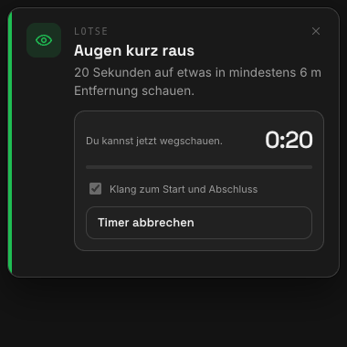

# Lotse – dein Pausen-Lotse für die Arbeit mit KI

**Lotse sagt dir, wann dein Kopf eine Pause braucht.** Die kleine Mac-App sitzt in der Menüleiste.
Sie sieht, wie viele Projekte und KI-Agenten gerade parallel laufen, und zeigt dir das als Ampel.
Sie erinnert dich ans Trinken, an den Wechsel zwischen Sitzen und Stehen und an echte Pausen.

Lotse ist für alle, die viele Stunden am Rechner mit Claude Code, Codex, ChatGPT oder Claude Desktop arbeiten.

## Download für den Mac

**[⬇ Lotse 0.1.0 herunterladen (.dmg)](https://github.com/clauszeissler-dot/arbeitsplatz_selfcare/releases/download/lotse-0.1.0/Lotse.dmg)** · [Alle Release-Dateien](https://github.com/clauszeissler-dot/arbeitsplatz_selfcare/releases/tag/lotse-0.1.0)

Für **Apple Silicon (M1 oder neuer), ab macOS 13**. Mit Developer ID signiert und von Apple notarisiert.
DMG öffnen und **Lotse** in den Ordner **Programme** ziehen.

📖 **[Anleitung auf Deutsch](docs/ANLEITUNG.md)** · 🇬🇧 **[User guide in English](docs/GUIDE.en.md)**

## Was Lotse für dich tut

- **Ampel in der Menüleiste:** Grün, Gelb oder Rot, je nachdem, wie viel du gerade gleichzeitig überwachst.
- **Erkennt deine Arbeit:** Lotse liest deine Tabs im Terminal Ghostty und sieht, in welchem Tab gerade ein KI-Agent arbeitet. ChatGPT, Claude Desktop und die Codex App zählen mit.
- **Dein Arbeitsrhythmus:** Die Erinnerungen richten sich nach erkannter Aktivität. Der Rhythmus beginnt beim Arbeiten, nicht allein beim App-Start.
- **Trinken:** Lotse erinnert dich alle 45 Minuten an ein Glas, damit du über 8 Stunden auf 2 Liter kommst.
- **Haltung:** Lotse startet mit Bürostuhl, Swopper, Stehen und Balance Board. Jede Person kann ihre Haltungen samt Wechselintervall lokal ergänzen oder entfernen.
- **Pausen wie bei Fluglotsen:** Spätestens nach 75 Minuten ist eine kurze Pause fällig, nach 2 Stunden eine lange Pause. Die Dauern sind einstellbar.
- **Tageszeitleiste:** Im Cockpit siehst du, welche erkannten Projekte oder KI-Aufgaben wann begonnen haben, wie lange sie aktiv waren und wann deine Pausen begonnen und geendet haben.
- **Klare Farblogik:** Fokus folgt der Ampel in Grün, Gelb und Rot. Eine laufende Pause ist überall Cyan und damit eindeutig vom Belastungszustand getrennt.
- **Startbare Übungstimer:** Die optionale Augenpause bietet **20 Sekunden in die Ferne schauen**; Pausen nutzen deine eingestellte Dauer. Mit **Starten** beginnt ein sichtbarer Countdown. Er bleibt bis **Fertig** oder **Abbrechen** stehen und meldet den Abschluss auf Wunsch mit einem Klang.
- **Eigene Klangwelt:** Sanfte, lokale Klänge für **Hinweis, Start und Abschluss**. Alle drei kannst du in den Einstellungen probehören. Der Hinweisklang ist abschaltbar; Timer haben einen eigenen Klangschalter.
- **Nur Hinweise, kein Zwang:** Eine kleine Karte oben rechts. Ohne laufenden Timer verschwindet sie nach der eingestellten Sichtdauer (standardmäßig 40 Sekunden).
- **Selbstheilende Oberfläche:** Falls die lokale Verbindung zur Oberfläche kurz aussetzt, versucht das Cockpit sie erneut aufzubauen und bietet statt eines schwarzen Fensters **Erneut verbinden** an. Verpasste Hinweisereignisse werden beim Öffnen nachgeholt.
- **Fenster wiederfinden:** Bei geöffnetem Cockpit erscheint Lotse im **Dock und in ⌘Tab**. Schließt du das Fenster, läuft die App in der Menüleiste weiter.
- **Sichere Updates aus GitHub:** Ab Version 0.2.0 prüft Lotse beim Öffnen des Cockpits den offiziellen GitHub-Release-Feed. Installation und Neustart erfolgen erst nach deinem Klick; akzeptiert werden nur kryptografisch signierte Universal-Pakete.
- **Ruhe im Meeting:** Ist deine Kamera oder dein Mikrofon an, kommen keine Hinweise.

## Gut zu wissen

- **Nur für den Mac:** Lotse läuft ab macOS 13. Eine Windows-Version ist geplant.
- **Arbeitsdaten bleiben auf deinem Rechner:** Lotse überträgt keine Aktivitäts-, Tab- oder Verlaufsdaten. Für die Updateprüfung ruft die App ausschließlich die öffentlichen offiziellen Release-Dateien bei GitHub ab.
- **Lokaler Schutz:** Einstellungen, höchstens 60 Tageszusammenfassungen und die heutige begrenzte Aufgaben-/Pausenzeitleiste liegen unverschlüsselt, aber mit Benutzerrechten `0700`/`0600` geschützt. Die Zeitleiste speichert nur gekürzte Anzeigenamen und Zeitwerte; Tabtitel, Arbeitsverzeichnisse und vollständige Prozessargumente werden nicht dauerhaft gespeichert.
- **Keine Garantie für deine Gesundheit:** Lotse ist eine Erinnerungshilfe, kein Medizinprodukt. Die Startwerte beruhen auf Studien und Empfehlungen. Hör trotzdem auf deinen Körper.
- **Woher die Werte kommen:** [Recherche und Quellen](docs/RECHERCHE.md)

## Stand

Der aktuelle fertige Download ist weiterhin Version 0.1.0 für Apple Silicon und ist signiert sowie von Apple notarisiert. Der Quellstand bereitet Version 0.2.0 mit Universal-Build und sicheren GitHub-Updates vor. Weil 0.1.0 noch keinen Updater enthält, muss diese erste Aktualisierung einmalig manuell installiert werden; danach kann Lotse weitere Updates selbst anbieten.
Alternativ kannst du die App selbst bauen: [Anleitung](docs/ANLEITUNG.md#installieren).

## Lizenz und eigene Versionen

**Nutzen und teilen ist erlaubt:** Die unveränderte offizielle, signierte und notarisierte Lotse-App darfst du verwenden und weitergeben. Die beiliegenden Lizenz- und Herkunftshinweise bleiben erhalten.

**Selbst bauen und verändern ist ebenfalls erlaubt:** Der Projekt-Quellcode, die Dokumentation und die Lotse-Klänge stehen unter [Apache-2.0](LICENSE). Veröffentliche Änderungen unter **eigenem Namen, eigener App-Kennung und eigener Entwickleridentität**. Die Marke KI AffAIrs, originale Logos und Claus' Developer ID werden nicht zur Nutzung für eigene Releases freigegeben. Urheberhinweise bleiben auch bei eigenen Versionen erhalten.

Details: [NOTICE](NOTICE) · [Marken, Originalweitergabe und eigene Builds](BRANDING.md) · [Sicherheitsrichtlinie](SECURITY.md).

## Für Entwickler

Aufbau, Tests und Bauen: [docs/ENTWICKLUNG.md](docs/ENTWICKLUNG.md) ·
Signieren und Notarisieren mit Apple Developer ID: [docs/RELEASE.md](docs/RELEASE.md)

---

Ein Projekt von **KI AffAIrs** – Claus Zeißler, Dortmund.
