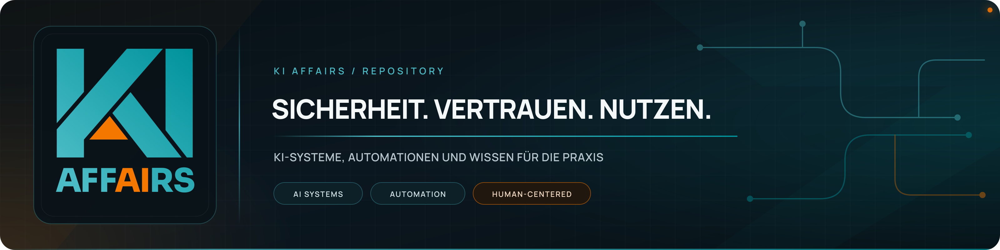
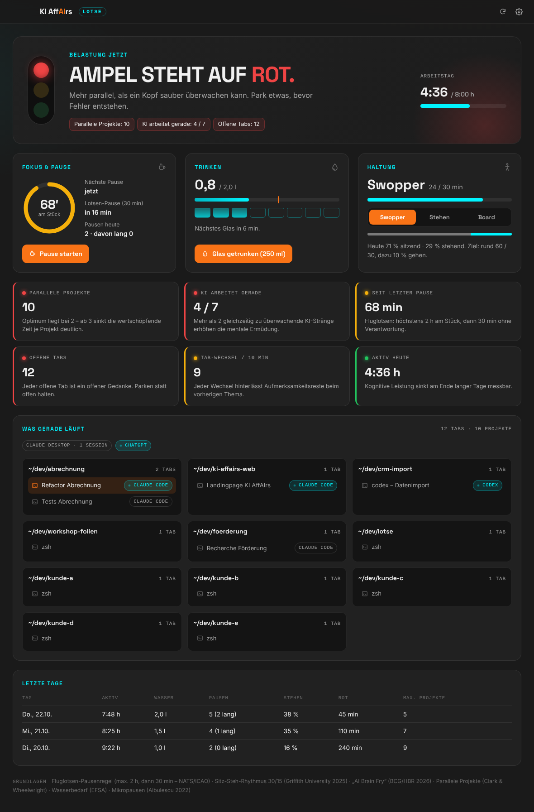
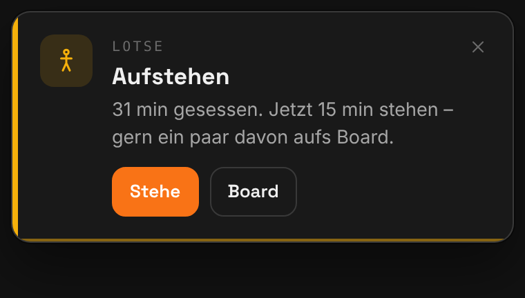

# Lotse – dein Pausen-Lotse für die Arbeit mit KI

**Lotse sagt dir, wann dein Kopf eine Pause braucht.** Die kleine Mac-App sitzt in der Menüleiste.
Sie sieht, wie viele Projekte und KI-Agenten gerade parallel laufen, und zeigt dir das als Ampel.
Sie erinnert dich ans Trinken, an den Wechsel zwischen Sitzen und Stehen und an echte Pausen.

Lotse ist für alle, die viele Stunden am Rechner mit Claude Code, Codex, ChatGPT oder Claude Desktop arbeiten.

📖 **[Anleitung auf Deutsch](docs/ANLEITUNG.md)** · 🇬🇧 **[User guide in English](docs/GUIDE.en.md)**

## Was Lotse für dich tut

- **Ampel in der Menüleiste:** Grün, Gelb oder Rot, je nachdem, wie viel du gerade gleichzeitig überwachst.
- **Erkennt deine Arbeit:** Lotse liest deine Tabs im Terminal Ghostty und sieht, in welchem Tab gerade ein KI-Agent arbeitet. ChatGPT und Claude Desktop zählen mit.
- **Trinken:** Lotse erinnert dich alle 45 Minuten an ein Glas, damit du über 8 Stunden auf 2 Liter kommst.
- **Haltung:** Lotse führt dich im Wechsel durch 30 Minuten Sitzen und 15 Minuten Stehen, gern mit Balance Board.
- **Pausen wie bei Fluglotsen:** Spätestens nach 75 Minuten ist eine kurze Pause fällig, nach 2 Stunden eine Pause von 30 Minuten.
- **Nur Hinweise, kein Zwang:** Eine kleine Karte oben rechts, die nach 40 Sekunden von selbst verschwindet; ein optionaler Erinnerungston lässt sich in den Einstellungen bewusst einschalten.
- **Ruhe im Meeting:** Ist deine Kamera oder dein Mikrofon an, kommen keine Hinweise.

## Gut zu wissen

- **Nur für den Mac:** Lotse läuft ab macOS 13. Eine Windows-Version ist geplant.
- **Alles bleibt auf deinem Rechner:** Lotse schickt keine Daten ins Internet.
- **Keine Garantie für deine Gesundheit:** Lotse ist eine Erinnerungshilfe, kein Medizinprodukt. Die Startwerte beruhen auf Studien und Empfehlungen. Hör trotzdem auf deinen Körper.
- **Woher die Werte kommen:** [Recherche und Quellen](docs/RECHERCHE.md)

## Stand

Lotse ist eine erste Version (0.1). Fertige, signierte Downloads gibt es noch nicht.
Bis dahin baust du die App selbst. Wie das geht, steht in der [Anleitung](docs/ANLEITUNG.md#installieren).

## Für Entwickler

Aufbau, Tests und Bauen: [docs/ENTWICKLUNG.md](docs/ENTWICKLUNG.md) ·
Signieren und Notarisieren mit Apple Developer ID: [docs/RELEASE.md](docs/RELEASE.md)

---

Ein Projekt von **KI AffAIrs** – Claus Zeißler, Dortmund.
